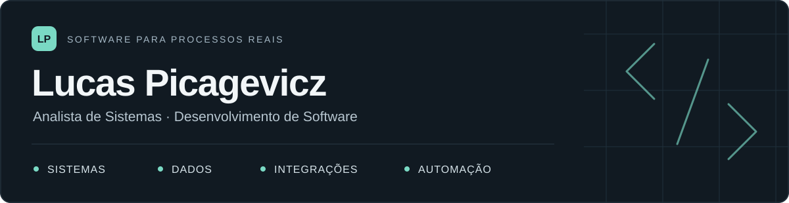

### Software para processos reais

Sou **Lucas Picagevicz**, analista de sistemas e desenvolvedor de software. Trabalho com sistemas hospitalares, produtos web, dados e automações — do entendimento da rotina à aplicação em uso.

**[Explorar meu portfólio ↗](https://lucaspicagevicz.com.br)** &nbsp;·&nbsp; **[Conversar por e-mail](mailto:lucaspicagevicz7@gmail.com)**

---

### Onde atuo

- **Sistemas hospitalares:** Tasy, Oracle/SQL, indicadores e integrações para rotinas que exigem rastreabilidade.
- **Sistemas e produtos web:** aplicações internas, painéis administrativos, sites e catálogos.
- **Dados e automações:** APIs, dashboards e serviços para conectar informações e reduzir etapas manuais.

### Projetos selecionados

| Projeto | O que desenvolvi | Conheça |
| :--- | :--- | :--- |
| **Sistema hospitalar interno** | Módulos com controle de acesso, auditoria e integrações. | [Visão técnica](https://lucaspicagevicz.com.br/projects/projeto-secreto/) |
| **MB Mobile Tech** | Catálogo, consulta de preços e geração de orçamentos. | [Ver projeto](https://lucaspicagevicz.com.br/projects/mb-mobile-tech/) |
| **Mecânica Avenida** | Site e gestão de orçamentos, agenda e atendimentos. | [Ver projeto](https://lucaspicagevicz.com.br/projects/mec-avenida/) |
| **Instituto Veneza / Skate House** | Aplicação web com painel administrativo e autenticação. | [Ver projeto](https://lucaspicagevicz.com.br/projects/instituto-veneza-skate-house/) |
| **WooCommerce + impressão térmica** | Serviço Python para imprimir pedidos com controle de duplicidade. | [Ver automação](https://lucaspicagevicz.com.br/projects/automacao-woocommerce-termica/) |

Também construí os sites da **[Lembranças da Luna](https://lucaspicagevicz.com.br/projects/lembrancas-da-luna/)** e da **[Florê Doces Finos](https://lucaspicagevicz.com.br/projects/flore-doces-finos/)**.

Os projetos profissionais têm código privado. No portfólio, apresento o contexto, as decisões técnicas e as demonstrações que podem ser compartilhadas.

### Tecnologias no meu trabalho

| Frente | Ferramentas |
| :--- | :--- |
| Interfaces | React · Next.js · TypeScript · JavaScript · HTML · CSS |
| Backend e automação | Node.js · Python · APIs REST |
| Dados e BI | Oracle · SQL · PostgreSQL · WeKnow |
| Ambiente hospitalar | Tasy · Integrações · Auditoria · Rastreabilidade |

### Como trabalho

Entendo o processo com quem usa, organizo as regras de negócio, construo a solução e valido o resultado na rotina. Gosto de conectar a visão técnica ao problema que precisa ser resolvido.

---

**Tem um sistema, integração ou processo para melhorar?**  
[Veja os projetos no portfólio](https://lucaspicagevicz.com.br) ou [me escreva](mailto:lucaspicagevicz7@gmail.com).
